# Cattle drone sim: preview

A synthetic scene for drone perception: Gumtree Creek Station, a fictional beef cattle property in the Queensland dry tropics, built and rendered in NVIDIA Isaac Sim. The source code is private. This repository holds the site map, a short clip of the render outputs, a note on how they were made, and a check of a pretrained cattle detector on labelled drone photos.

## Why simulation

A drone that musters cattle has to find, count and track them from the air. Open drone datasets with cattle, and two with sheep:

| Dataset | Contents | Limits |
|---|---|---|
| [ACFR UAV Cattle Detection](http://data.acfr.usyd.edu.au/Agriculture/UAVCattleDetection/), University of Sydney ([Brown et al. 2022](https://arxiv.org/abs/2110.01329)) | 478 photos, Marulan, New South Wales, nadir, 40-50 m. Boxes: 4,721 cattle, 2,567 sheep, 342 dogs | Stills. No licence stated |
| ICAERUS grazing cows, Zenodo [11048412](https://zenodo.org/records/11048412) (v2), [10245396](https://zenodo.org/records/10245396) (v1) and [8234156](https://zenodo.org/records/8234156) (raw) | 1,385 photos, farms in France, nadir, 60 and 100 m (v1 also 30 m). 4,941 cow and calf boxes. Raw release: about 900 photos, no labels | Stills. Nadir only |
| [Annotated cows in aerial images](https://doi.org/10.7910/DVN/N7GJYU), GenTORE, with a [test split](https://zenodo.org/records/14219057) | Photos, Juchowo, Poland and Wageningen, the Netherlands, 5-80 m, mostly nadir. 3,393 cow boxes in 741 photos | Stills. Dairy cattle |
| Shao et al. 2020, [mirror on Dataset Ninja](https://datasetninja.com/cattle-detection-and-counting-in-uav-images) | 670 photos, one pasture in Aso, Japan, nadir, about 50 m. About 1,950 cattle boxes | Stills. CC BY-NC-ND 4.0 |
| [NelloreBeefCattleDataset](https://github.com/EvertonTetila/NelloreBeefCattleDataset) ([Torrente et al. 2026](https://arxiv.org/abs/2611.08928)) | 839 photos of Nellore feedlot pens, Brazil, 13 flights, 15 m. 232 photos with back and head boxes | Feedlot. No whole-animal boxes. No licence stated |
| [UAV LiDAR and RGB for cattle growth monitoring](https://zenodo.org/records/13364663) ([Wang et al. 2025](https://doi.org/10.1038/s41597-025-04783-6)) | Simmental cattle in pens, China. Lidar point clouds of single animals with body measurements and weights. 138 RGB frames, 8-15 m, with cattle boxes | Pens. Not every animal labelled |
| [AerialCattle2017](https://data.bris.ac.uk/data/dataset/3owflku95bxsx24643cybxu3qh), University of Bristol | 46,340 RGB crops from drone video, tracks of 23 Friesian cows | Crops of single cows. Non-commercial licence |
| [COW_MOTS](https://zenodo.org/records/6370315) | 7 thermal drone sequences, two farms in the Netherlands, 8-28 m. 239 tracks, 20,647 masks | Thermal only |
| [RF100 aerial-cows](https://universe.roboflow.com/object-detection/aerial-cows) | 1,723 frames with cow boxes, 640x640 px | Place and heights not stated |
| Passing sheep, Zenodo [12094356](https://zenodo.org/records/12094356) and [18889878](https://zenodo.org/records/18889878) | Drone video of flocks, labelled for counting | Sheep |

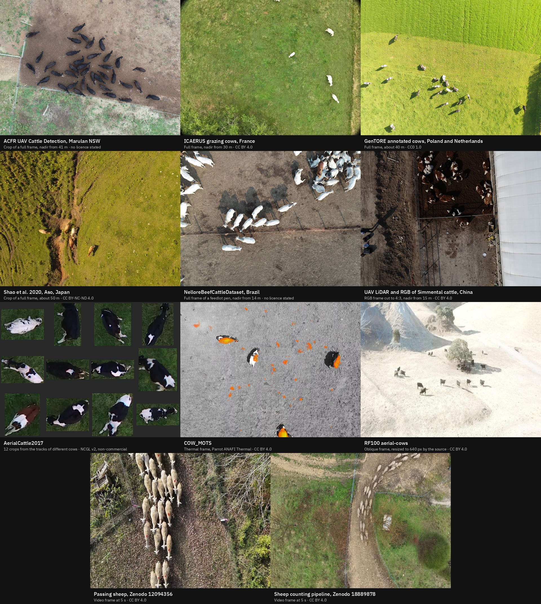

One sample from each dataset, with its licence.

The training data comes from simulation, with Gumtree Creek Station as its testing ground. Every frame rendered here comes with exact class and instance masks, depth, simulated thermal and lidar. The camera, height, light and herd can be changed, and the same flight can be replayed. The real sets above are for fine-tuning and the real-world test.

## Pretrained detector on labelled drone photos

A check of a ready-made cattle detector on real labelled photos.

- Data: ICAERUS v2, farm Mauron, France, 7 Nov 2023, 15:49:10-15:49:20. 13 photos from a DJI Mavic 3E at 60 m, about one per second. 156 labelled boxes of 12 cattle.
- Detector: the YOLO11s cattle model of Yan et al. 2026 ([weights](https://huggingface.co/Arvin26/Cattle-detection-model)), trained on a Brazilian feedlot at 10-15 m, run on 640 px SAHI tiles.
- Metric: precision, recall and F1 per photo at IoU 0.5. Cattle found: tracks matched to the 12 labelled animals.

[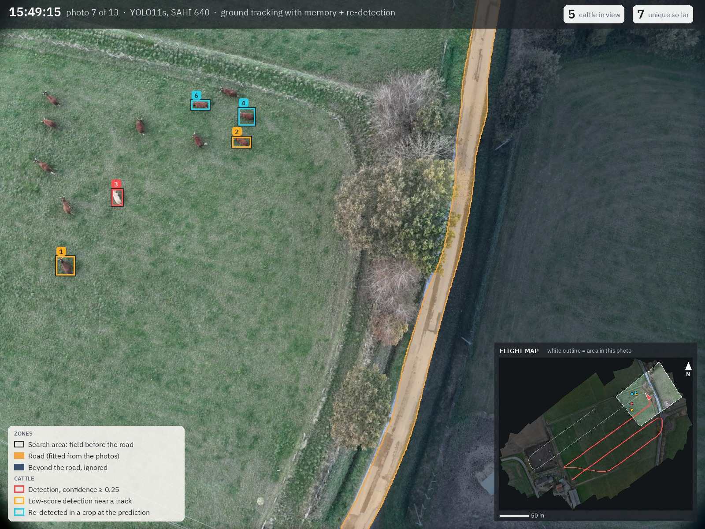](pretrained_check.mp4)

[`pretrained_check.mp4`](pretrained_check.mp4): 15 s, the 13 photos at the real pace between a title and the result. Red: detection with confidence 0.25 or more. Amber: weaker detection near a track. Cyan: re-detected. Inset: map built from the 113 photos of the flight, with the area of the current photo.

| Step | Precision | Recall | F1 | Cattle found |
|---|---|---|---|---|
| Naive: detector on each photo, confidence 0.25 or more | 0.59 | 0.40 | 0.48 | - |
| + only the field before the road | 0.89 | 0.40 | 0.56 | - |
| + tracking on the ground | 0.89 | 0.40 | 0.56 | 9 of 12 |
| + memory: weaker detections near a track | 0.85 | 0.53 | 0.65 | 11 of 12 |
| + re-detection in a turned crop | 0.85 | 0.56 | 0.67 | 11 of 12 |

How F1 went from 0.48 to 0.67:

- Zone filter. The road is found in the photos by colour and fitted as a curve on the ground. Detections on the road and beyond it are dropped. Precision 0.59 to 0.89.
- Tracking on the ground. Poses come from COLMAP over the 113 photos of the flight, aligned to GPS (0.36 m median residual), with the DJI lens calibration. Each detection becomes a point in metres; a Kalman filter links the points across photos.
- Memory. A track predicts where its animal should be and accepts detections down to confidence 0.02 there. Recall 0.40 to 0.53.
- Re-detection. A track without a detection is searched again in a 640 px crop centred on its prediction and turned to the orientation of its last confident photo. Recall 0.53 to 0.56.

Thresholds were chosen on other ICAERUS flights, not on this window. The detector still misses 44% of the cattle per photo.

## Render outputs

[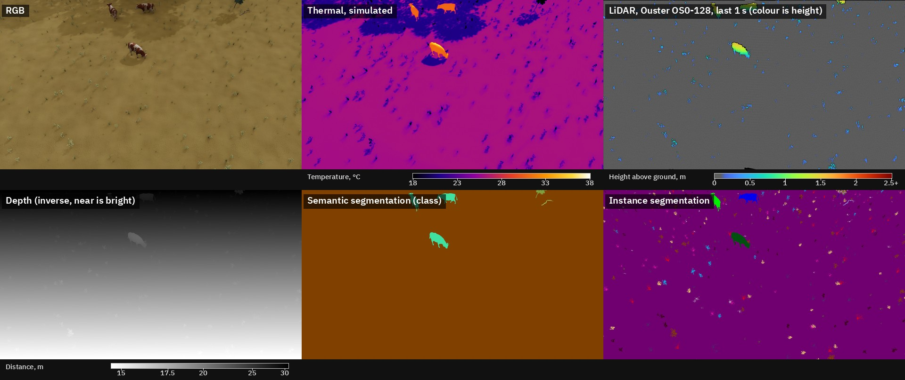](herd_pass_tiles.mp4)

[`herd_pass_tiles.mp4`](herd_pass_tiles.mp4): 10 s at 30 fps, 1920×808. Each tile is the same frame: RGB, simulated thermal, lidar, depth, class segmentation and instance segmentation. Colour bars under the thermal, lidar and depth tiles give their scales. The classes in view, by share of pixels: pasture 98.97 %, cow 0.71 %, tree 0.31 %, log 0.01 % and shrub under 0.01 %.

## Site map

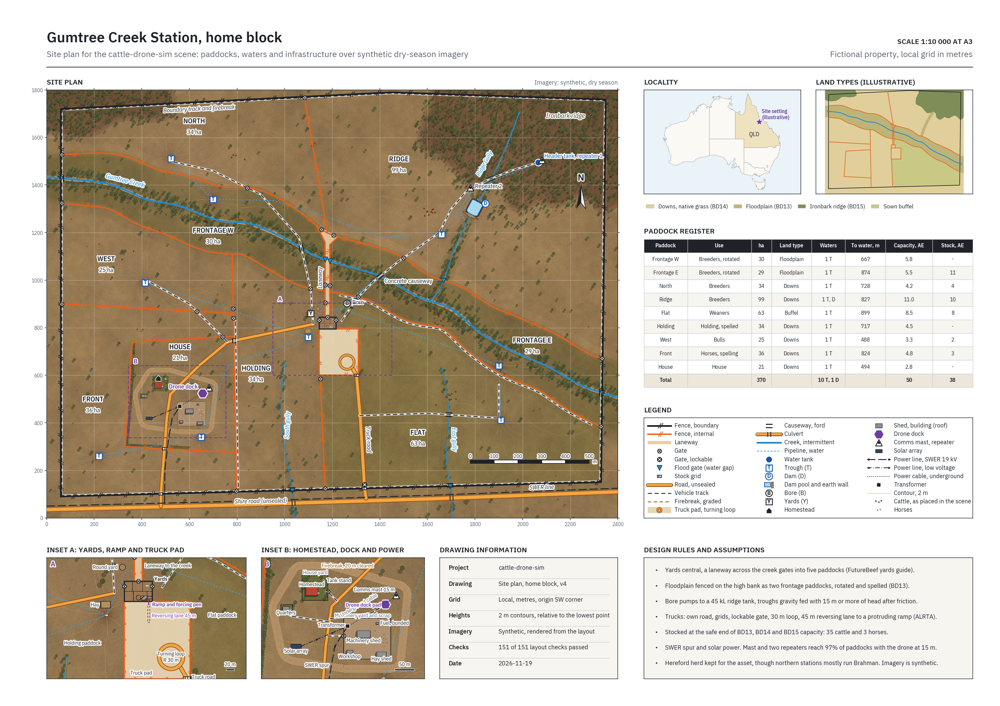

## Scene views

Stills rendered in Isaac Sim from cameras around the home block, with the same sun and sky as the clip.

| | |
|:-:|:-:|
| 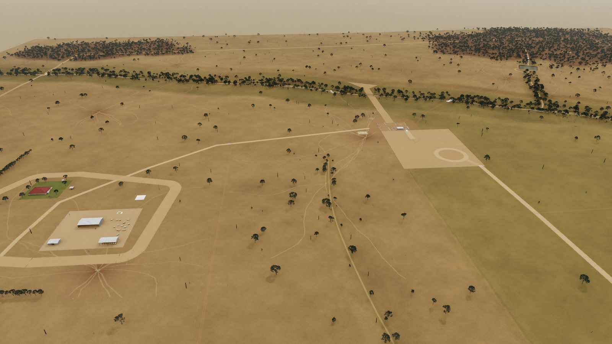 The home block from 380 m: homestead and shed pad on the left, cattle yards by the creek, the dam and ridge woodland behind | 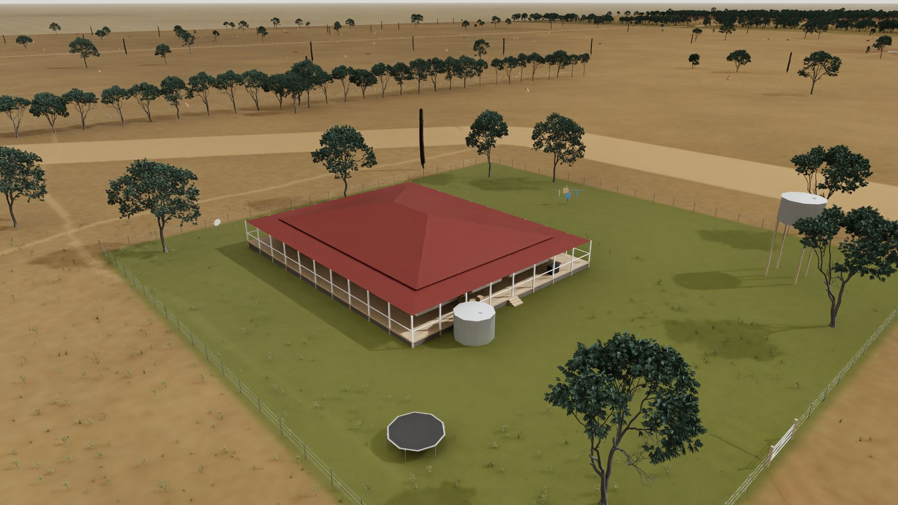 Homestead with its verandah, lawn, rainwater tank and tank stand |
| 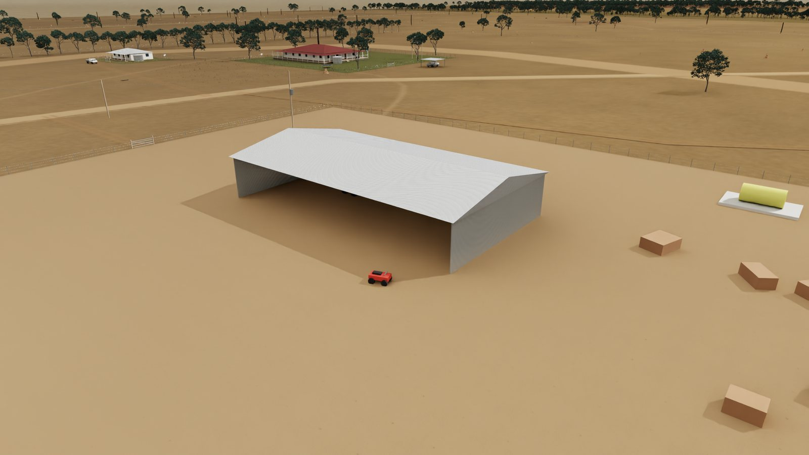 Machinery shed on the shed pad, with a vehicle and the bunded diesel tank | 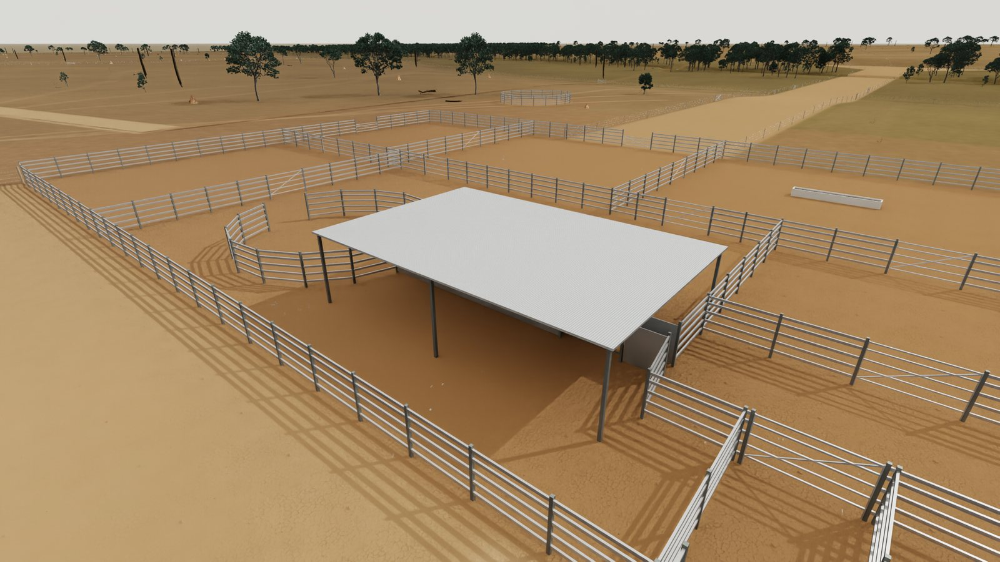 Cattle yards: pens, gates and the roofed work area over the race and crush |
| 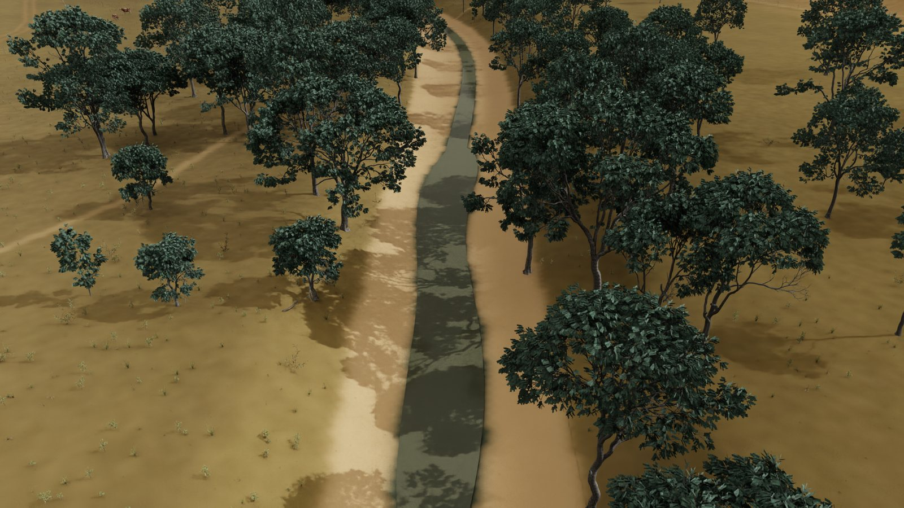 A waterhole on the creek, with the low-flow stream running on along the bed, eucalypts on the banks | 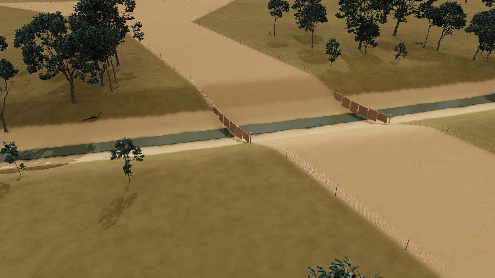 Flood gates where a fence crosses the creek, with the stream running under them |
| 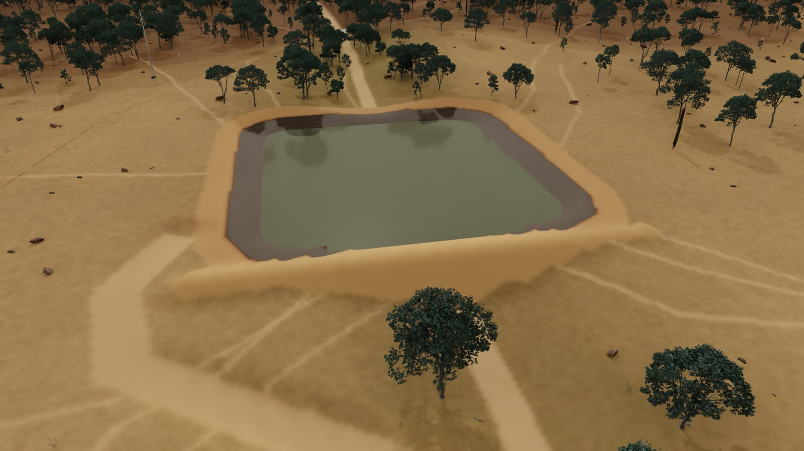 Stock dam with its earth wall | 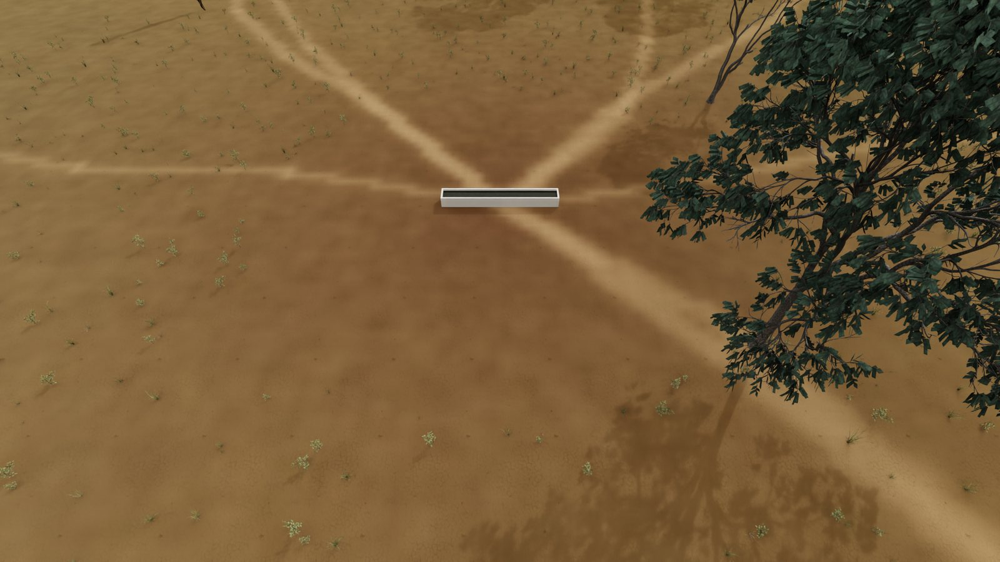 Concrete trough with cattle pads converging on it |
| 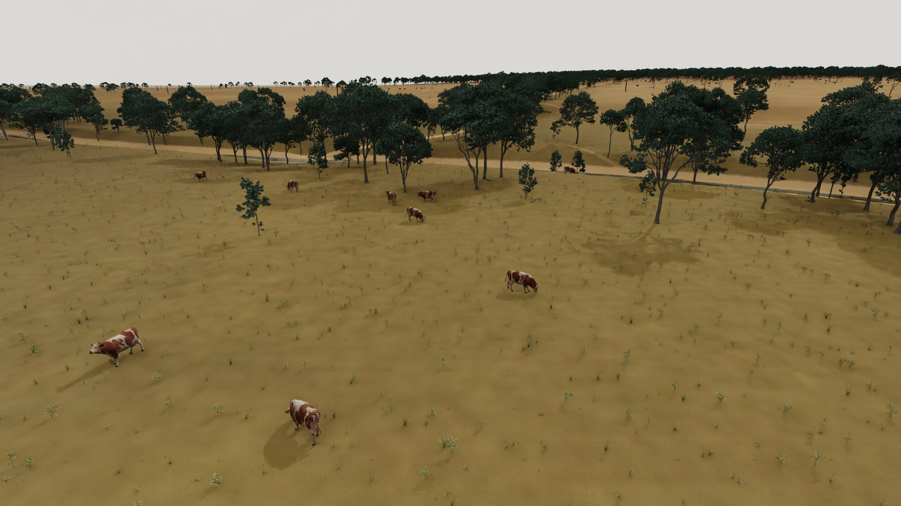 Hereford cows grazing, with the creek woodland behind | 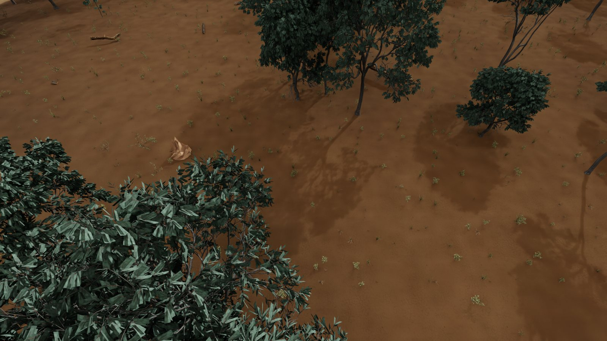 Ridge woodland on red soil |

## How the renders were made

- **Layout.** The property is described in Python: paddocks, fences and gates, creek, dam, tracks, cattle yards, buildings, power and troughs. A validator runs 151 checks on stocking, water and infrastructure rules, on the layout and on the built scene.
- **Terrain.** A 2 m elevation model with the creek channel, dam and fords cut in. Ground classes such as tracks, road, creek bed and dam wall are meshes draped on the same triangles. The ground colour is a synthetic dry-season orthophoto drawn from the layout, with a Poly Haven detail normal map on top.
- **Scene.** Pure USD layers written with `pxr`: terrain, ground classes, fences, structures, power, vegetation, ground cover and herd. 8,066 eucalypts are instanced from 15 Sketchfab models. About 28,800 tussocks, shrubs, logs, rocks and termite mounds come from Poly Haven models. 35 Hereford cows play looped skeletal animations, each with its own phase.
- **Light.** A distant light is the sun. The sky is a Poly Haven HDRI with the sun painted out, plus a light distance haze.
- **Labels.** 42 semantic classes, set with the USD `LabelsAPI`.
- **Capture.** Isaac Sim 6.2 with Omniverse Replicator. The camera orbits the herd 15 m above the ground, looking 50° down through a 24 mm lens on a 36 mm wide sensor, at 1280×720 and 30 fps. The annotators are `rgb`, `semantic_segmentation`, `instance_id_segmentation_fast` and `distance_to_image_plane`. Depth is stored as 16-bit millimetres, and the depth video shows inverse depth stretched over the clip. Segmentation colours are spread apart in CIELAB.
- **Thermal.** A second Isaac Sim pass over the same flight and animation times. Every material is overridden to glow at the temperature of its semantic class, for a clear dry-season morning in shade: cattle 31 °C, bare ground 24 °C, pasture 21 °C, trees 19 °C and water 18 °C. Albedo is one low grey with no specular or normal maps, so the sun adds about 5 °C to lit ground and shadows read cooler. Leaf and grass cut-outs keep their alpha. The sky and haze are off. The linear `HdrColor` output is turned back into degrees, blurred to about 640 px across with 50 mK of noise and shown in an ironbow palette from 18 to 38 °C. It is an approximation by class, not a radiometric simulation.
- **LiDAR.** An RTX lidar with NVIDIA's Ouster OS0-128 model (128 channels, 1024 columns, 10 Hz) rides 0.25 m above the camera with its spin axis pitched 45° forward. The timeline plays in 1/60 s steps along the same orbit, and every full scan is kept in world coordinates. The points match the camera depth to 1.3 cm (median). Each frame shows the scans of the last second, projected into the camera. Ground points are grey and points above the ground are coloured by height, up to 2.5 m. Gaps between scan lines are filled only between points at the same depth, and eye-dome lighting shades the edges.
- **Purpose.** The depth and segmentation videos are prepared as control inputs for NVIDIA Cosmos Transfer.
- **Known limits.** Trees and tussocks are instanced, so the instance mask gives one colour per model, not per plant. In the thermal pass the back faces of leaf cards do not emit, so trees at the top edge read too cold from about 5 s on. The lidar view holds fewer scans in its first second, so the first frames are coarser.

The site map is drawn with matplotlib from the same layout, over synthetic imagery rendered from it. The property is fictional and the grid is local, in metres.

## Credits

| Asset | Author | Source | Licence | Changes |
|---|---|---|---|---|
| Animated-cow (Hereford) | emptypen2477 | [Sketchfab](https://sketchfab.com/3d-models/animated-cow-a47ed54e35fc4dbfadeadde68219cb70) | [CC BY 4.0](https://creativecommons.org/licenses/by/4.0/) | Converted to USD, animations looped |
| eucalypt-pack | local.yany | [Sketchfab](https://sketchfab.com/3d-models/eucalypt-pack-559dea7f60ba4d69977002ae4fb919ff) | [CC BY 4.0](https://creativecommons.org/licenses/by/4.0/) | Converted to USD, instanced with random scale |
| eucalypt pack | local.yany | [Sketchfab](https://sketchfab.com/3d-models/eucalypt-pack-0e92f292b8fa437eb888a945fb02c88c) | [CC BY 4.0](https://creativecommons.org/licenses/by/4.0/) | Converted to USD, instanced with random scale |
| Models, ground textures, sky `kloofendal_48d_partly_cloudy_puresky` | Poly Haven | [polyhaven.com](https://polyhaven.com) | [CC0](https://creativecommons.org/publicdomain/zero/1.0/) | Materials replaced, sun removed from the sky |
| IBM Plex Sans (map, clip and collage text) | IBM Corp. | [IBM Plex](https://github.com/IBM/plex) | [SIL OFL 1.1](https://openfontlicense.org) | None |
| Admin 1 states and provinces, 1:50m (map inset) | Natural Earth | [naturalearthdata.com](https://www.naturalearthdata.com/downloads/50m-cultural-vectors/) | Public domain | None |
| ACFR UAV Cattle Detection (collage) | J. Brown, Y. Qiao, C. Clark, S. Lomax, K. Rafique, S. Sukkarieh, University of Sydney | [data.acfr.usyd.edu.au](http://data.acfr.usyd.edu.au/Agriculture/UAVCattleDetection/) | No licence stated | One photo cropped to 4:3 and resized |
| Annotated Cows in Aerial Images, test set (collage) | Cameron Appel, from the GenTORE set by G.J. Franke and Sander Mücher | [Zenodo 14219057](https://zenodo.org/records/14219057) | [CC BY 4.0](https://creativecommons.org/licenses/by/4.0/) | One photo resized |
| Cattle Detection and Counting in UAV Images (collage) | Wen Shao, Rei Kawakami, Ryota Yoshihashi, Shaodi You, Hidemichi Kawase, Takeshi Naemura | [Dataset Ninja](https://datasetninja.com/cattle-detection-and-counting-in-uav-images) | [CC BY-NC-ND 4.0](https://creativecommons.org/licenses/by-nc-nd/4.0/) | One photo cropped to 4:3 and resized |
| NelloreBeefCattleDataset (collage) | Everton Castelão Tetila and co-authors | [GitHub](https://github.com/EvertonTetila/NelloreBeefCattleDataset) | No licence stated | One photo resized |
| Dataset for cattle growth monitoring in PLF using UAV-based LiDAR (collage) | Yaowu Wang and co-authors | [Zenodo 13364663](https://zenodo.org/records/13364663) | [CC BY 4.0](https://creativecommons.org/licenses/by/4.0/) | One RGB frame cropped to 4:3 and resized |
| aerial-cows, Roboflow 100 (collage) | Omar Kapur, wwblodge, Ricardo Jenez, Justin Jeng, Jeffrey Day | [Roboflow Universe](https://universe.roboflow.com/object-detection/aerial-cows) | [CC BY 4.0](https://creativecommons.org/licenses/by/4.0/) | One frame cropped to 4:3 |
| AerialCattle2017 (collage) | W. Andrew, C. Greatwood, T. Burghardt, University of Bristol | [data.bris.ac.uk](https://data.bris.ac.uk/data/dataset/3owflku95bxsx24643cybxu3qh) | [Non-Commercial Government Licence v2](https://www.nationalarchives.gov.uk/doc/non-commercial-government-licence/version/2/) | 12 crops resized into a grid |
| Dataset of UAV thermal video sequences with annotations for MOTS benchmarking (collage) | Diego Bárbulo, Joao Valente | [Zenodo 6370315](https://zenodo.org/records/6370315) | [CC BY 4.0](https://creativecommons.org/licenses/by/4.0/) | One frame cropped to 4:3 and resized |
| Drone raw images of cattle in french grazing areas (collage) | Adrien Lebreton | [Zenodo 8234156](https://zenodo.org/records/8234156) | [CC BY 4.0](https://creativecommons.org/licenses/by/4.0/) | One photo resized |
| Drone videos and their annotations of passing sheep (collage) | Louise Helary and co-authors | [Zenodo 12094356](https://zenodo.org/records/12094356) | [CC BY 4.0](https://creativecommons.org/licenses/by/4.0/) | One video frame resized |
| Drone videos to test sheep counting computer vision pipeline (collage) | Adrien Lebreton and co-authors | [Zenodo 18889878](https://zenodo.org/records/18889878) | [CC BY 4.0](https://creativecommons.org/licenses/by/4.0/) | One video frame resized |
| Drone images and their annotations of grazing cows (detector check) | Louise Helary, Adrien Lebreton | [Zenodo 11048412](https://zenodo.org/records/11048412) | [CC BY 4.0](https://creativecommons.org/licenses/by/4.0/) | 13 photos undistorted and resized, zones and boxes drawn; flight map built from 113 photos |
| Cattle detection model, YOLO11s (detector check) | Jianglong Yan and co-authors | [Hugging Face](https://huggingface.co/Arvin26/Cattle-detection-model) | [CC BY 4.0](https://creativecommons.org/licenses/by/4.0/) | Used as is |

## Licence

The map, the clip, the preview image and the scene stills are released under [CC BY 4.0](https://creativecommons.org/licenses/by/4.0/). The detector check video and still `pretrained_check.*` are released under CC BY 4.0 as well and contain ICAERUS photos (CC BY 4.0). When you reuse them, also credit the third-party assets above. The dataset collage `datasets.jpg` stays under the licences of its sources, listed above. The AerialCattle2017 crops and the Shao et al. sample are for non-commercial use only. The ACFR and NelloreBeefCattleDataset samples have no stated licence.
